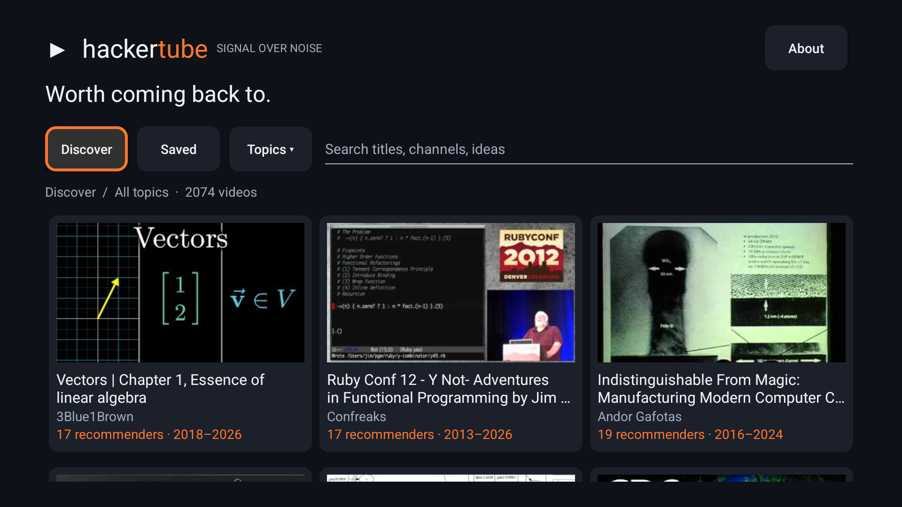

# HackerTube for Google TV

**An unofficial Google TV app built on [Andrej Karpathy’s HackerTube](https://hackertube.org/).**

Andrej’s project did the work of finding and analyzing videos repeatedly recommended on Hacker News. **The video catalog, HN recommendation evidence, summaries, topics, and ranking scores all come from his published dataset.** This repo adds a remote-friendly Android TV interface and in-app playback—not a new scraping or recommendation pipeline.

[Original project](https://hackertube.org/) · [Andrej’s announcement](https://x.com/karpathy/status/2116957135661945283) · [Upstream data](https://hackertube.org/data)

> [!WARNING]
> **AI-slopped together for my own TV. Published as-is, not maintained for others.**
> No promises of support, fixes, security updates, or PR reviews. Fork it and do your thing. The original app code is MIT-licensed; third-party data and content retain their own terms. This is not an official HackerTube app or a claim of platform-policy compliance.



## What it does

- Browse, search, filter by topic, and save videos with your TV remote.
- Watch **inside the app**, using YouTube’s embedded player.
- Full-screen cinema mode, play/pause, and 10-second seeking.
- Subtitles off by default, with an available-language picker.
- Durations on thumbnails and details, plus the HN comments behind each recommendation.

The bundled catalog contains **2,074 of the upstream export’s 6,454 videos**: at least three recommenders, in three distinct months, across two calendar years; news excluded. It keeps HackerTube’s original ranking scores. This is a conservative filter of the exported evidence, not a fresh analysis.

## Build and install

Requires **JDK 17**, Android SDK **35**, and build-tools **35.0.0**. Set `JAVA_HOME` and `ANDROID_HOME`, then:

```sh
./gradlew assembleDebug
# Enable wireless debugging on the TV; pair first if required:
adb pair TV_IP:PAIRING_PORT
scripts/install-tv.sh TV_IP:DEBUG_PORT
```

Put Android’s `platform-tools` on your `PATH`. The APK is at `app/build/outputs/apk/debug/app-debug.apk`. This is a debug-signed sideload build, not a Play Store release. Turn debugging off afterward.

In **Cinema**: center plays/pauses, left/right seek, down shows controls, and Back returns to details.

## Caveats

A current Android System WebView is required. YouTube controls ads, embed permissions, and its own player UI; some videos won’t play. Subtitle controls depend on the options YouTube exposes. This isn’t an isolated YouTube kiosk or a policy-reviewed public release.

The catalog works offline. Thumbnails and playback contact YouTube; durations are fetched from `hackertube.org` and cached locally. Saved videos stay on your device. The embed may use cookies and device/app attestation. See [technical notes and privacy details](docs/DEVELOPMENT.md).

## Credit and license

Credit for the underlying project and curation belongs to **Andrej Karpathy / [HackerTube](https://hackertube.org/)**, with HN archive data from **[open-index/hacker-news](https://huggingface.co/datasets/open-index/hacker-news)**. Comments belong to their authors; videos and imagery belong to their creators. This app is not affiliated with or endorsed by those projects, YouTube, or Y Combinator.

**Original app code: [MIT](LICENSE). Upstream dataset: ODC-By 1.0.** See [NOTICE.md](NOTICE.md) for attribution and separate licensing, and [the upstream data documentation](docs/DATA.md) for how the dataset was made.
